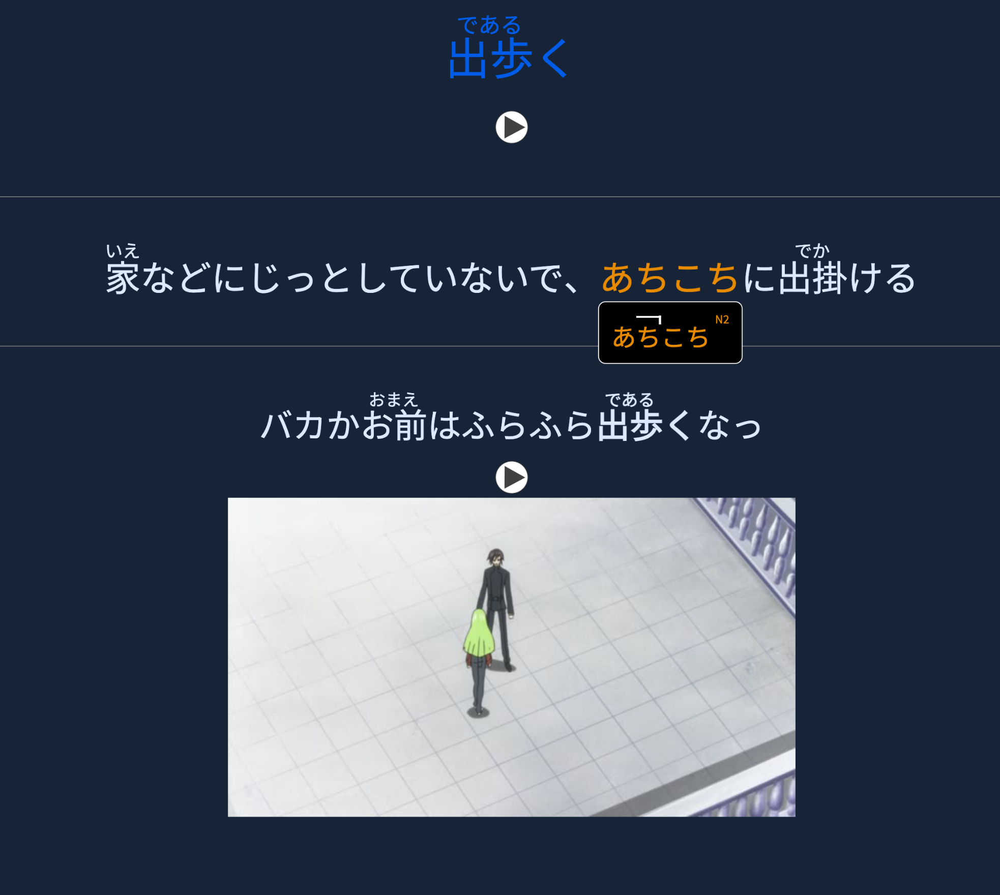
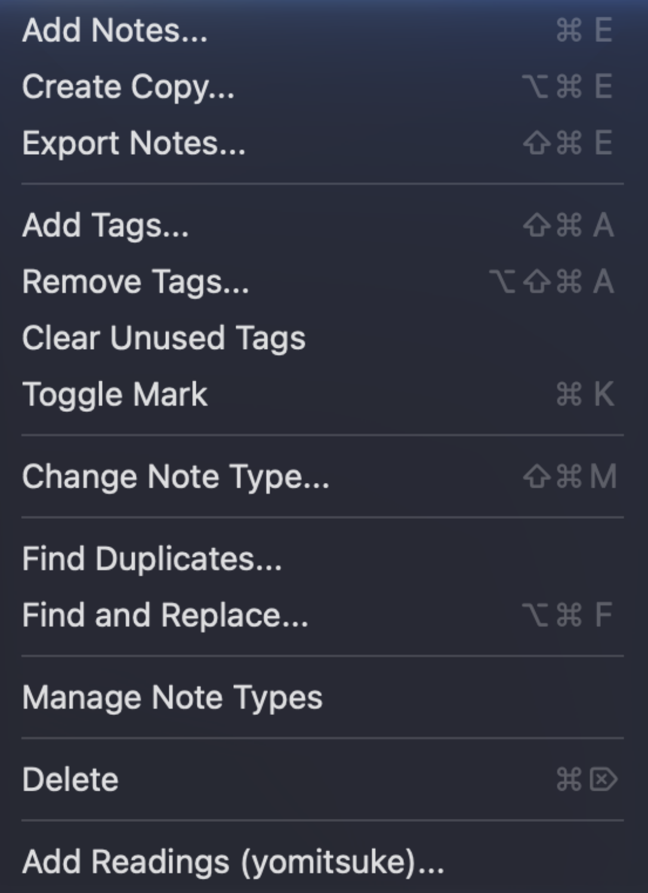
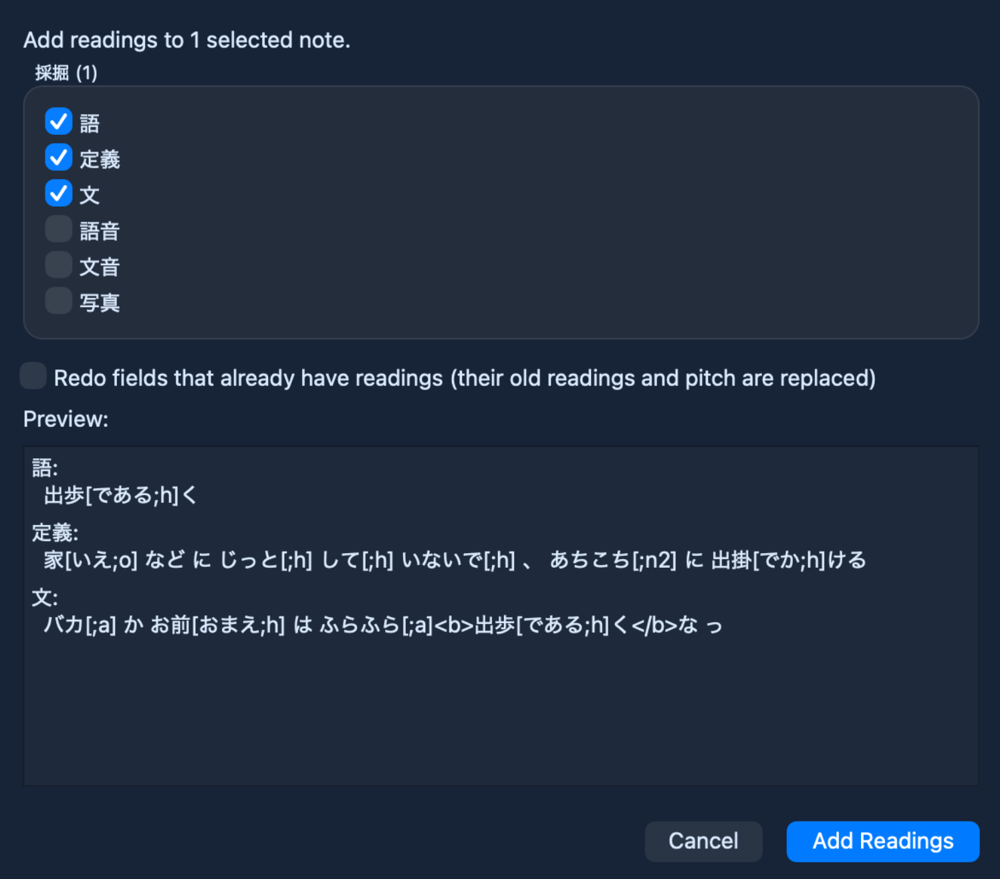
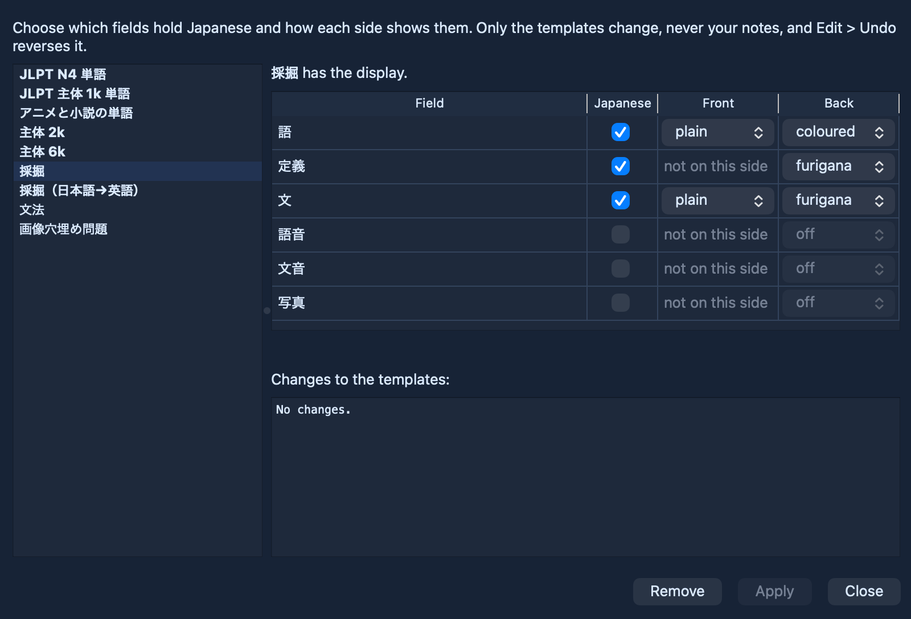
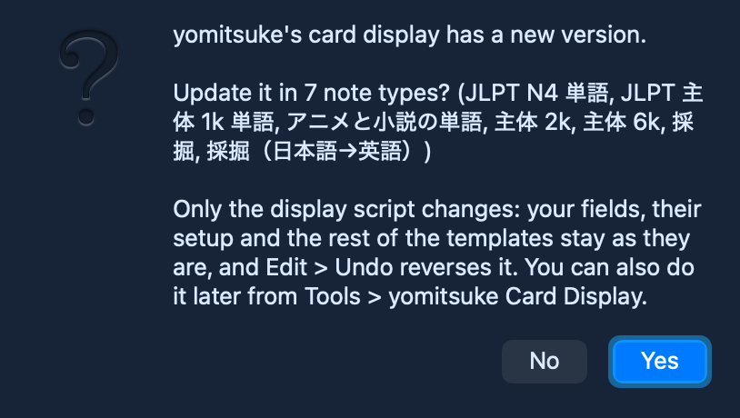
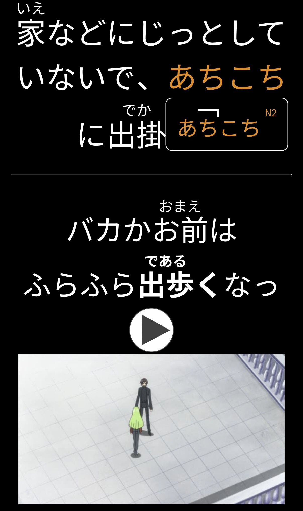

# yomitsuke（読み付け）

an anki add-on that adds furigana and pitch accent to cards, in bulk, and displays them on every device



yomitsuke works in two parts:

- **add readings** writes each word's reading and pitch into your notes, as text like `出歩[である;h]く`
- **the card display** is a small script in your note type that draws that text as furigana, pitch colours and a pitch graph. it lives in the card templates, so it works on mobile too, with nothing to install there

everything is bundled, so it works offline with nothing else to install. made for anki 26.09 and later

## add readings

select notes in the browser and choose **Notes > Add Readings (yomitsuke)**, or right-click them



tick the fields to fill, check the preview, and press **Add Readings**



- bold, sound tags, images and english are left as they are
- fields that already have readings are skipped, unless you tick redo
- the ticked fields are remembered per note type, and once a note type has the card display, only its japanese fields are listed
- the whole batch is one undo step: Edit > Undo

### the format

one word at a time, separated by spaces: the kanji, then the reading and pitch in brackets, then any kana after it

```
出歩[である;h]く   家[いえ;o] など に じっと[;h] して[;h] いないで[;h]
```

- `じっと[;h]`: a word written in kana gets just its pitch
- `追[お,おいかける;k4]いかけたい`: a verb or adjective with a drop also carries its dictionary form, which the pitch graph is drawn from
- particles and endings stay bare

## the card display

**Tools > yomitsuke Card Display** puts the display into a note type. pick the note type, tick the fields that hold japanese, and choose how each side shows them



| mode | what you see |
|---|---|
| off | the field as it is, brackets and all |
| plain | the text without its readings, for the front of a card |
| furigana | readings over the kanji; the pitch colour and graph show on hover or tap |
| coloured | readings over the kanji, and each word always in its pitch colour |

ticking a field fills in plain for the front and furigana for the back

the window only changes yomitsuke's own markers in the templates: a wrapper round each japanese field and one script block at the end. the rest of your templates, your styling and your notes stay exactly as they are. open it again any time to add or drop fields, or **Remove** to take the display out. every change is one undo step, and nothing forces a full sync

when an update brings a new version of the display, yomitsuke offers once to put it into your note types



### pitch colours

| | code | pattern |
|---|---|---|
| 🟦 | `h` | heiban: flat, no drop |
| 🟥 | `a` | atamadaka: drops after the first mora |
| 🟧 | `n2`, `n3`… | nakadaka: drops after that mora |
| 🟩 | `o` | odaka: drops after the last mora, onto the particle |
| 🟪 | `k1`, `k2`… | a verb or adjective with a drop |

change any of them in the note type's styling, for example `.card { --ym-heiban: #3366ff; }`

### on your phone

the display is part of the note type, so it syncs with your cards. tap a word to see its pitch graph, and scroll to close it



## how it reads

- words are split by [fugashi](https://github.com/polm/fugashi) (MeCab) with the [UniDic](https://clrd.ninjal.ac.jp/unidic/) dictionary, which also picks readings from context
- pitch comes from [Kanjium](https://github.com/mifunetoshiro/kanjium)'s list of about 118,000 words first, and UniDic's own accents otherwise. a word with more than one pitch gets the first
- a short hand-checked list fixes words UniDic reads wrong

it's a dictionary and a word splitter, not a person, so names and rare words can come out wrong. fix them in the field, or teach yomitsuke once:

### your own fixes

**Tools > Add-ons > yomitsuke > View Files** opens the add-on's folder. in `user_files/my-readings.tsv`, one word per line: the word, a tab, the reading, and optionally a tab and a pitch code

```
遠坂	とおさか	h
```

your fixes win over everything else and survive updates

## install

- **[ankiweb](https://ankiweb.net/shared/info/1899043297):** Tools > Add-ons > Get Add-ons, and paste the code `1899043297`
- **from github:** download `yomitsuke.ankiaddon` from the [latest release](https://github.com/coleshanks/yomitsuke/releases/latest), then Tools > Add-ons > Install from file

then restart anki. yomitsuke needs anki 26.09 or later

tested on macos. windows and linux are bundled and should work, but haven't been tried yet: if something breaks, please [open an issue](https://github.com/coleshanks/yomitsuke/issues)

the display keeps working without the add-on, since it lives in your templates. to take it out, use **Remove** in the card display window for each note type

## development

```sh
uv sync
uv run pytest                                     # tests
uv run python tools/build.py                      # dist/yomitsuke.ankiaddon
uv run python tools/score.py <collection.anki2> <note type>   # compare with notes that already have readings
uv run python tools/display.py                    # the display on its own, to read or paste by hand
uv run python tools/rename.py                     # every place the name appears
```

## licence

[MIT](LICENSE). bundled data and libraries keep their own licences: Kanjium (CC BY-SA 4.0), fugashi and unidic-lite (MIT), MeCab and UniDic (BSD), listed in [NOTICE.md](NOTICE.md). the pitch accent notation was provided by Uros O. through his free database
